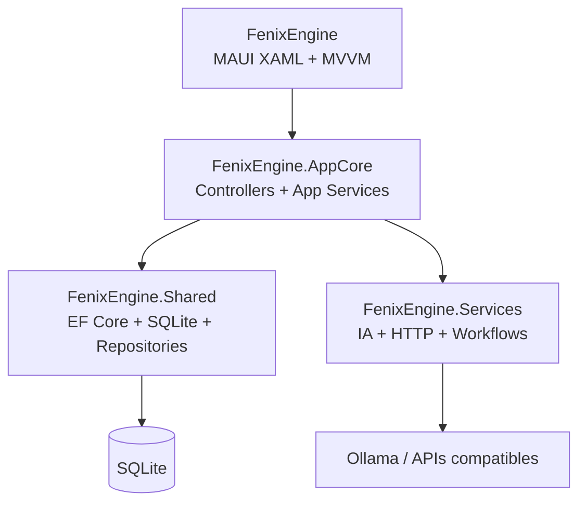

# Documento RUP - FenixEngine

## 1. Control del documento

| Campo | Valor |
|---|---|
| Proyecto | FenixEngine |
| Tipo de documento | Documento de visión y arquitectura basado en RUP |
| Estado | Línea base documental contrastada con el código disponible |
| Fecha de revisión | 2026-10-15 |
| Plataforma | .NET MAUI |
| Persistencia | SQLite con Entity Framework Core |
| Audiencia | Arquitectura, análisis, desarrollo y validación |

> Esta revisión describe lo que está presente en el repositorio a la fecha indicada. "Implementado" significa que existe código para la capacidad; no implica que esté probado en todos los destinos ni integrado de extremo a extremo en la UI.

## 2. Resumen ejecutivo

FenixEngine es una aplicación .NET MAUI para organizar proyectos de desarrollo asistido por IA, equipos/agentes, artefactos y tareas internas. FEAT-001 aporta el ecosistema multi-proveedor; FEAT-002 agrega un agregado de proyecto de desarrollo separado del portfolio legacy. La solución conserva las capas UI, AppCore, Services y Shared, con SQLite/EF Core para datos locales.

El código actual tiene una base navegable y consultas conectadas a SQLite. FEAT-001 agrega un catálogo configurable de proveedores, modelos, agentes y equipos, con conectores OpenAI-compatible, Gemini y Ollama. Los servicios de prompt y RUP ahora requieren un proveedor/modelo explícitos; la UI administra el ecosistema, pero todavía no ofrece una pantalla para ejecutar workflows.

El producto se encuentra en etapa de prototipo funcional. El CRUD de Development Projects, asignación de equipos y registro de artefactos está disponible en UI y SQLite; FEAT-001 administra proveedores/modelos/agentes/equipos y guarda API keys en `SecureStorage`. Siguen pendientes seguridad de autenticación, CRUD de tareas, auditoría de cambios completa, ejecución de workflows desde UI y pruebas automatizadas. FEAT-002 no ejecuta agentes ni genera código.

## 3. RUP: Incepción

### 3.1 Problema

Los equipos necesitan convertir decisiones de arquitectura y especificaciones de diseño en estructuras de proyectos, documentos, tareas y acciones repetibles. Este trabajo suele estar disperso entre herramientas de chat, editores, terminales y documentos independientes.

### 3.2 Oportunidad

Centralizar la interacción con agentes de IA y conservar el contexto de desarrollo permite:

- reducir tareas manuales;
- mantener trazabilidad;
- reutilizar flujos de generación;
- organizar actividades por proyecto;
- producir documentación técnica con una estructura conocida.

### 3.3 Visión del producto

FenixEngine permitirá iniciar o mantener proyectos de software a partir de especificaciones humanas, ejecutar flujos asistidos por IA, generar artefactos técnicos y conservar el historial de decisiones y actividades en una aplicación multiplataforma.

### 3.4 Actores

| Actor | Descripción |
|---|---|
| Arquitecto de software | Define stack, arquitectura, restricciones y objetivos del proyecto. |
| Analista o desarrollador | Ejecuta prompts, revisa resultados y gestiona tareas. |
| Usuario autenticado | Consulta proyectos, actividades, tareas y configuración. |
| Agente local | Servicio Ollama u otro endpoint local compatible. |
| Proveedor cloud | Servicio de IA externo configurado por el usuario. |
| Sistema de archivos | Destino de documentos y estructuras generadas. |

### 3.5 Casos de uso principales

- Iniciar sesión.
- Consultar dashboard de proyectos.
- Crear un nuevo proyecto.
- Consultar actividades.
- Filtrar actividades por proyecto y texto.
- Consultar tareas agrupadas por proyecto.
- Configurar proveedores cloud.
- Configurar agentes locales.
- Ejecutar un prompt.
- Generar un documento RUP.
- Generar una estructura de proyecto.
- Registrar resultados y actividad.

### 3.6 Alcance de la versión actual

La versión actual cubre el login local de demostración, el portfolio interno legacy, el módulo Development Projects con características, estado, equipos y artefactos, y la administración UI del ecosistema IA. El CRUD completo de tareas, sesión/autorización, auditoría de revisiones y la UI de ejecución de workflows permanecen pendientes. FEAT-001/002 no implementan generación de código, ejecución multiagente, RAG ni chats persistentes.

## 4. RUP: Elaboración

### 4.1 Arquitectura candidata

La arquitectura se divide en los siguientes bloques:

### 4.2 Componentes principales

#### Presentación

- Páginas MAUI XAML en `FenixEngine.UI/Src/Components/pages`.
- ViewModels en `FenixEngine.UI/Src/ModelView`.
- Binding mediante `BindingContext` y comandos.
- `CollectionView` en las páginas de consulta de proyectos, actividades y tareas.
- `App` inicia con `NavigationPage(LoginPage)`; `AppShell` existe, pero no es la navegación usada por el arranque actual.

#### Aplicación

- `ProjectPortfolioController` coordina consultas para el portfolio.
- `WorkflowController` coordina ejecución de prompts, RUP y arquitectura.
- `AuthenticationService` valida usuarios contra SQLite.
- `ProjectDataService` transforma entidades en DTOs de presentación.
- `SettingsDataService` transforma la configuración persistida para la UI.

#### Datos

- `ServiceDbContext` define el modelo EF Core.
- SQLite almacena usuarios, proyectos, actividades, tareas legacy y el nuevo catálogo de proveedores/modelos/agentes/equipos.
- Repositorios encapsulan consultas y operaciones de persistencia.
- `DatabaseInitializer` crea o actualiza la base durante el arranque.

#### Integraciones

- Cliente HTTP para endpoints de IA.
- No hay un endpoint/modelo por defecto activo en los workflows; se requieren `AiProvider` y `ModelIdentifier` explícitos.
- El UI AI Ecosystem sí invoca conectores para probar conexión y sincronizar modelos; la UI no ejecuta prompts ni workflows.
- Servicios comunes de archivos, carpetas, terminal y logging.
- Hay un servicio externo Gemini parcial y generadores/controladores experimentales adicionales; no equivalen a proveedores configurables y listos para producción.

### 4.3 Modelo de dominio actual

#### Usuario

`UserArchitect` representa al usuario de la aplicación y contiene identidad, correo y hash de contraseña para el entorno de pruebas.

#### Proyecto

`GeneralProyects` representa un proyecto gestionado en FenixEngine. Se relaciona con `ProyectType` y puede tener actividades y tareas.

#### Actividad

`UserActivity` registra la participación o actividad de un usuario en un proyecto.

#### Tarea

`ProjectTask` representa una actividad ejecutable o completada con estado, prioridad, fechas y proyecto asociado.

#### Configuración

- `AiApiToken` representa proveedores cloud y sus tokens.
- `LocalAgentConfiguration` representa endpoints locales como Ollama.

### 4.4 Requisitos funcionales

| ID | Requisito | Estado |
|---|---|---|
| RF-01 | Iniciar sesión local | Implementado para demostración; sin sesión persistente ni autorización posterior |
| RF-02 | Consultar proyectos | Implementado en lectura; actualmente lista todos los proyectos locales, sin filtro por usuario |
| RF-03 | Consultar actividades por proyecto | Implementado en lectura con datos SQLite |
| RF-04 | Buscar actividades y seleccionar proyecto | Implementado en WorkStation; filtro de texto en memoria sobre título/proyecto |
| RF-05 | Consultar tareas agrupadas por proyecto | Implementado en lectura; no hay edición desde la UI |
| RF-06 | Consultar proveedores cloud y agentes locales | Implementado en lectura |
| RF-07 | Guardar configuración de IA | Implementado para proveedores, modelos, agentes y equipos mediante el módulo AI Ecosystem; Settings legacy continúa en lectura |
| RF-08 | Crear/editar/eliminar proyectos internos legacy | Pendiente en `GeneralProyects`; los proyectos IA se cubren en FEAT-002/RF-201–RF-204 |
| RF-08 | Crear/editar/eliminar proyectos de desarrollo IA | Implementado mediante Development Projects; `GeneralProyects` sigue siendo el portfolio interno legacy |
| RF-09 | Ejecutar prompt con configuración elegida | Parcial: el servicio requiere proveedor/modelo explícitos y delega al conector; no hay acción UI de ejecución |
| RF-10 | Generar documento RUP | Parcial/legacy: ahora requiere proveedor/modelo explícitos; no está conectado a UI y FEAT-001 no implementa generación RUP |
| RF-11 | Generar estructura de proyecto | Parcial: crea carpetas `src`, `docs`, `tests` y README; no genera solución/código ni está conectado a UI |
| RF-12 | Registrar historial de actividades/workflows | Parcial: se consultan actividades sembradas; los workflows no persisten resultados ni nuevas actividades |
| RF-13 | Resolver proveedor/modelo desde configuración | Parcial: el catálogo y los conectores están implementados; la UI aún no inicia workflows ni elige agente para ejecutarlos |
| RF-14 | Administrar tareas (crear/editar/eliminar) | Parcial: repositorio permite Add/Update; la UI es de solo lectura y no hay eliminación |
| RF-15 | Registrar/consultar agentes IA | Implementado en AgentsPage con selección obligatoria de modelo habilitado |
| RF-16 | Administrar proveedores y catálogo de modelos | Implementado en ProvidersPage y ModelsPage; sincronización depende de conectividad y credenciales válidas |
| RF-17 | Crear equipos y asignar agentes | Implementado en TeamsPage; la ejecución colaborativa del equipo está fuera de alcance |

### 4.5 Requisitos no funcionales

- **RNF-01:** La aplicación debe ejecutarse en las plataformas soportadas por .NET MAUI.
- **RNF-02:** La UI no debe acceder directamente a DbContext.
- **RNF-03:** La lógica de negocio debe permanecer en AppCore.
- **RNF-04:** Las integraciones externas deben permanecer en Services.
- **RNF-05:** La persistencia debe estar encapsulada en Shared y repositorios.
- **RNF-06:** Los controles deben mantener contraste suficiente.
- **RNF-07:** La aplicación debe soportar funcionamiento local sin depender siempre de una API remota.
- **RNF-08:** Los tokens de proveedores no deben almacenarse sin protección en producción.
- **RNF-09:** El sistema debe poder actualizar el esquema de datos mediante migraciones.

## 5. RUP: Construcción

### 5.1 Iteración actual

La iteración actual mantiene la base funcional de consulta y establece una arquitectura por capas. MVVM existe, aunque algunas páginas cargan datos mediante métodos síncronos que bloquean sobre operaciones asíncronas.

Entregables realizados:

- solución MAUI compilable;
- capas Shared, Services y AppCore;
- páginas principales;
- ViewModels;
- SQLite y entidades EF Core;
- repositorios concretos;
- inicialización de base para pruebas;
- autenticación local de pruebas;
- consultas de proyectos, actividades y tareas;
- servicios de workflow.

### 5.2 Flujo de inicio

1. `FenixEngine.UI/MauiProgram.cs` construye el contenedor DI y registra Shared, Services y AppCore.
2. Se registran Shared, Services, AppCore y ViewModels.
3. Se inicializa SQLite.
4. En `DEBUG` y `RELEASE`, `DatabaseInitializer.Initialize` conserva la base, aplica compatibilidad legacy y ejecuta migraciones.
5. `App` inicia una `NavigationPage` con `LoginPage`.
6. El usuario se autentica.
7. La aplicación navega a `MainPage`.

### 5.3 Flujo de consulta del dashboard

1. `MainPage` resuelve `MainPageViewModel`.
2. El ViewModel solicita datos al `ProjectPortfolioController`.
3. AppCore usa `ProjectDataService`, que consulta `IProjectRepository`.
4. EF Core ejecuta la consulta sobre SQLite y devuelve la lista ordenada por edición/creación.
5. Los DTOs se exponen mediante el binding `Projects`. La consulta actual no aplica autorización ni filtro de propietario.

### 5.4 Flujo de ejecución de IA

1. No hay acción de UI/ViewModel que inicie actualmente un prompt o workflow de producto.
2. Si otro caller invoca `WorkflowController`, debe proporcionar un `AiProvider` y `ModelIdentifier` explícitos para prompt/RUP.
3. `PromptExecutionService` y `RupDocumentService` resuelven el conector por `ProviderType`; las API keys se leen desde `IApiKeyStore` y se envían como headers.
4. El módulo UI usa esos conectores para probar proveedor y sincronizar modelos. No se ejecuta generación de código, RAG ni coordinación multiagente.
5. Los resultados de workflow no se guardan en historial; la UI de ejecución permanece pendiente.

## 6. RUP: Transición

### 6.1 Actividades de transición pendientes

- Ampliar la estrategia EF Core para versionar también el esquema legacy; la migración FEAT-001 crea las tablas nuevas de forma idempotente y compatible.
- Definir filtro de acceso/propiedad para consultas de proyectos, actividades y tareas.
- Implementar login seguro (hash resistente con salt), sesión, logout y autorización.
- Conectar workflows a UI, conservar resultado/ruta y presentar errores controlados.
- Añadir UI de ejecución de workflows y seleccionar proveedor/modelo/agente sin defaults implícitos.
- Completar casos de uso y persistencia de proyectos, tareas y configuración.
- Añadir pruebas automatizadas de repositorios, AppCore, servicios HTTP y ViewModels.
- Validar targets MAUI disponibles y actualizar dependencias con vulnerabilidades conocidas.
- Eliminar o aislar los flujos experimentales que duplican la generación actual.

### 6.2 Criterios de aceptación de la próxima versión

- Un usuario de prueba puede iniciar sesión y la sesión/permiso se aplica también a las consultas.
- Dashboard, actividades y tareas reflejan únicamente datos autorizados.
- Crear/editar un proyecto persiste los datos y valida entradas.
- La administración del ecosistema IA persiste proveedores, modelos, agentes y equipos en SQLite.
- Un prompt iniciado desde una futura UI usa un proveedor/modelo seleccionado y devuelve contenido o error accionable.
- Generar RUP/estructura crea artefactos verificables y registra su ubicación.
- Errores/cancelación dejan un estado observable y registro sin ocultar causa.
- La inicialización/migración conserva datos existentes en RELEASE.
- Pruebas automatizadas cubren los casos críticos; targets soportados se validan en dispositivo/simulador.

## 7. Riesgos

| Riesgo | Impacto | Mitigación |
|---|---|---|
| Esquema legacy todavía depende de `EnsureCreated` y SQL manual | Alto | Completar un baseline EF versionado y probar actualización de bases existentes. |
| Contraseña de demostración y SHA-256 sin salt | Alto | Retirar credenciales de producción; usar mecanismo de autenticación/hash apropiado y gestión de sesión. |
| Tokens legacy pueden permanecer en `AiApiToken` en texto plano | Alto | No copiar esos valores al nuevo catálogo; re-registrar keys en `SecureStorage` y retirar/limpiar la tabla legacy en una fase controlada. |
| Workflows no alcanzables desde la UI y resultados descartados | Alto | Definir caso de uso/UI, resultado observable, cancelación y manejo de errores. |
| Lista de proyectos sin filtro de usuario | Alto | Definir autorización/propiedad antes de multiusuario. |
| Workflows no tienen selección desde UI | Medio | Incorporar una pantalla de ejecución que elija proveedor/modelo/agente habilitados. |
| Operaciones de UI bloquean al esperar métodos async | Medio | Exponer APIs async de extremo a extremo y manejar estados de carga. |
| Sin suite de pruebas en el inventario actual | Medio | Crear proyectos de pruebas y gates de CI. |
| Proveedores/agentes y generadores duplicados o incompletos | Medio | Consolidar contratos, registrar implementaciones efectivas y marcar prototipos. |

## 8. Decisiones y restricciones

- Se utiliza MAUI XAML para la UI actual.
- La UI debe depender de AppCore y de ViewModels, no de DbContext.
- Shared contiene persistencia y contratos comunes.
- Services contiene integraciones técnicas y proveedores de IA.
- AppCore coordina casos de uso.
- La base local se utiliza para facilitar operación y pruebas.
- El arranque ya no recrea la base en `DEBUG`; `Initialize` conserva datos y aplica `Migrate`. `Recreate` queda disponible solo para uso explícito de desarrollo.
- Las API keys del nuevo catálogo no se guardan en SQLite; `IApiKeyStore` abstrae `SecureStorage` para permitir reemplazo futuro por almacenes nativos.
- Los workflows requieren `AiProvider` y `ModelIdentifier`; no hay proveedor/modelo fallback en ejecución.
- Los destinos del proyecto MAUI dependen del sistema operativo de build: Android se declara siempre; iOS/MacCatalyst en plataformas no Linux; Windows solo en Windows.

## 9. Próximos incrementos

1. Seguridad de autenticación: autorización/propiedad, hash seguro, sesión y logout.
2. CRUD de tareas y filtro de proyectos según usuario.
3. Historial/auditoría de cambios del proyecto, más allá de `UpdatedAt`.
4. UI de ejecución de workflows: selección de agente/equipo, progreso, cancelación, resultado y errores.
5. Migración de esquema legacy: baseline y evolución versionada de tablas anteriores a FEAT-001.
6. Pruebas automatizadas y validación visual multiplataforma.
7. Consolidación de rutas experimentales; mantener generación de código fuera de FEAT-002.

## 10. Inventario de módulos contrastado con el código

| Proyecto / módulo | Responsabilidad y contenido observado | Estado |
|---|---|---|
| `FenixEngine.UI` | Aplicación MAUI, recursos, navegación, `MauiProgram`, páginas y ViewModels | CRUD de Development Projects y AI Ecosystem; CRUD de tareas pendiente |
| UI / autenticación | `LoginPage`, `LoginPageViewModel`; delega en `AuthenticationService` | Login local de prueba; no hay sesión ni logout |
| UI / portfolio | `MainPage`, `MainPageViewModel`; lista `ProjectSummary` | Lectura del portfolio legacy; nuevo proyecto y Proyectos IA navegan al módulo Development Projects |
| UI / WorkStation | Proyectos, selección y filtro de actividades en `WorkStationPageViewModel` | Lectura y filtro local implementados |
| UI / tareas | `TaskPage` y `TaskPageViewModel`; agrupación por nombre de proyecto | Solo lectura |
| UI / Settings | `SettingsPage` y `SettingsPageViewModel` | Settings legacy de lectura y navegación al módulo AI Ecosystem |
| UI / AI Ecosystem | ProvidersPage, ModelsPage, AgentsPage, TeamsPage y ViewModels MVVM | CRUD, conexión, sincronización y membresías mediante BindingContext/DI |
| UI / Development Projects | `ProjectsPage`, `ProjectCreatePage`, `ProjectDetailsPage`, `ProjectTeamsPage`, `ProjectArtifactsPage` | Lista/búsqueda/estado, CRUD, contexto, equipos y metadata de artefactos mediante MVVM |
| `FenixEngine.AppCore` / controladores | Portfolio, DTOs, `WorkflowController` y servicios de aplicación FEAT-001/002 | Casos de uso async de proyectos, equipos, artefactos y contexto; los workflows no tienen caller UI |
| AppCore / servicios | Authentication/data services, `AiEcosystemService`, `DevelopmentProjectService` | CRUD/filtros/validación de proyectos, equipos y artefactos; UI no accede directamente a repositorios |
| AppCore / ejecución experimental | `WorkflowEngine`, `Handlers`, `Sanitizant`, `ServiceHost`, contextos y nodos | Código de prototipo/legado; no confundir con los workflows registrados en DI |
| `FenixEngine.Shared` / dominio y datos | Modelos legacy, entidades de AI Ecosystem y `DevelopmentProject`, asignaciones y artefactos | Agregado de desarrollo independiente de `GeneralProyects`; enums de estado/tipo |
| Shared / repositorios | Repositorios legacy, repositorios IA y repos de proyectos/artefactos | CRUD async, filtros de proyecto, nombre único case-insensitive y relación N:M |
| Shared / servicios comunes | Archivos, carpetas, terminal y logging | Contratos/implementaciones disponibles para workflows |
| `FenixEngine.Services` / conectores | `IAProviderConnector`, factory, OpenAI-compatible, Gemini y Ollama | Validar, descubrir modelos y ejecutar prompt; extensibles mediante DI |
| Services / secretos/transporte | `IApiKeyStore`/`SecureApiKeyStore`, `IHttpClientService.SendAsync` | API keys en SecureStorage y headers; no aparecen en DTOs, listas ni logs |
| Services / workflow | `PromptExecutionService`, `RupDocumentService`, `ArchitectureProjectService` | Prompt/RUP requieren proveedor y modelo explícitos; no tienen UI de ejecución ni historial |
| Services / generación experimental | `LocalCodeGenerator`, prompt builder y `SystemFiles` | Ruta separada del workflow principal; alcance/uso no queda integrado en UI |
| `AiExternalService` | Integración Gemini en Shared | `GenerateContentAsync` implementado parcialmente; `GetExternalAsync` y `PostJsonAsync` lanzan `NotImplementedException`; no registrado en DI |
| Pruebas automatizadas | No se encontraron proyectos/archivos de pruebas en el inventario fuente | Pendiente |

### 10.1 Modelo de datos persistido

Las entidades y tablas centrales definidas en `FenixEngine.Shared/Src/Models/Model.cs` y `ServiceDbContext` son:

| Entidad | Uso observado | Observaciones |
|---|---|---|
| `UserArchitect` | Identidad local para login | Un usuario semilla de demostración; autenticación calcula SHA-256 simple |
| `GeneralProyects`, `ProyectType` | Proyectos y tipos | Consulta de proyectos; no hay caso de uso de alta/edición |
| `UserActivity` | Actividad asociada a usuario y proyecto | Solo lectura; el workflow no crea registros |
| `ProjectTask` | Tareas y estado/prioridad/fechas | Consulta y agrupación; repositorio permite alta/actualización |
| `AiApiToken` | Proveedores cloud legacy | Conservado por compatibilidad; el nuevo ecosistema no lee ni expone estos tokens |
| `LocalAgentConfiguration` | Configuración de agentes local legacy | Conservada por compatibilidad; AI Ecosystem mantiene su propio catálogo de proveedores |
| `AiProvider` | Proveedor, tipo, URL base, flags y fechas | No almacena API key; uno-a-muchos con modelos |
| `LlmModel` | Modelo registrado por proveedor | Identificador único por proveedor; ventana de contexto opcional |
| `AiAgent` | Nombre, rol, descripción, prompt de sistema y modelo | Se asocia a un único modelo |
| `AgentTeam`, `AgentTeamMember` | Equipo y relación muchos-a-muchos con agentes | Clave compuesta; cascada en membresías |
| `DevelopmentProject` | Unidad de trabajo de desarrollo asistido por IA | Requerimientos, arquitectura, stack, estado y activo; `UpdatedAt` registra la última modificación, no un historial de revisiones |
| `DevelopmentProjectTeam` | Relación muchos-a-muchos proyecto/equipo IA | Clave compuesta; AppCore exige al menos un equipo al crear/editar/asignar |
| `ProjectArtifact` | Metadata de artefactos asociados al proyecto | Tipo, título, descripción, ruta opcional y fecha; no genera archivos |
| `UserEmails`, `ComandTerminal`, `AgentRole`, `CollectAgents`, `LLMModels` | Modelos adicionales definidos en el archivo de dominio | No están expuestos como `DbSet` en el contexto actual |

### 10.2 Integración de dependencias y arranque

- `FenixEngine.UI/MauiProgram.cs` llama `UseSharedServices`, `UseEngineServices` y `UseEngineAppCore`, y registra los ViewModels de las páginas.
- `FenixEngine.AppCore/AppCoreExtension.cs` registra los tres servicios de workflow y servicios/controladores de aplicación.
- `FenixEngine.Shared/SharedExtension.cs` registra el DbContext SQLite y repositorios.
- En `DEBUG` y `RELEASE`, el arranque llama `DatabaseInitializer.Initialize`; `EnsureCreated` y SQL de compatibilidad conservan el esquema legacy, y `Migrate()` aplica `AiEcosystemSchema`.
- `AiEcosystemSchema` crea solo las cinco tablas del ecosistema con `CREATE TABLE/INDEX IF NOT EXISTS`; no recrea tablas ni reingresa semillas legacy. `Down` elimina únicamente tablas nuevas.
- `DevelopmentProjectsSchema` crea de forma idempotente las tablas `DevelopmentProjects`, `DevelopmentProjectTeams` y `ProjectArtifacts`; no modifica datos legacy.
- El target condicional `FenixEfDesign=true` y `FenixEngine.Migrations.DesignHost` permiten scaffold de EF desde `net10.0` sin arrancar MAUI.
- No se encontró un proyecto de pruebas ni una configuración de CI de tests en los archivos fuente enumerados para esta revisión.

## 11. Brechas funcionales y técnicas

| ID | Brecha | Prioridad | Criterio de cierre |
|---|---|---|---|
| GAP-01 | Autenticación débil para producción, sin sesión/logout | Alta | Hash resistente con salt, gestión de sesión, logout y pruebas |
| GAP-02 | Proyectos no filtrados por usuario ni administrables | Alta | Propiedad/autorización aplicada en consulta y CRUD persistente |
| GAP-02 | Development Projects aún no tienen propietario/autorización por usuario | Alta | Definir propiedad y aplicar autorización a consultas/cambios; CRUD local ya existe |
| GAP-03 | Workflows no disponibles desde la UI | Alta | Acción de UI, estado de progreso, cancelación y resultado visible |
| GAP-04 | Respuesta del prompt descartada y validación nominal | Alta | Resultado o artefacto visible; validación real y error observable |
| GAP-05 | No existe UI para seleccionar un agente y ejecutar workflows | Alta | Acción UI usa proveedor/modelo elegidos, muestra resultado y errores |
| GAP-06 | Tablas legacy siguen sin baseline de migraciones | Alta | Versionar el esquema previo y probar upgrade con datos reales |
| GAP-07 | Tareas parcialmente escribibles solo desde repositorio | Media | Casos de uso/UI para crear, editar, completar y eliminar según alcance |
| GAP-08 | Actividades solo consultables y datos seed | Media | Registro de eventos de dominio/workflow y política de retención |
| GAP-09 | APIs síncronas en controlador consumidas por UI | Media | APIs async de extremo a extremo sin bloqueo de hilo UI |
| GAP-10 | Servicios externos y generadores incompletos/duplicados | Media | Contratos únicos; implementaciones activas registradas y probadas |
| GAP-11 | Sin pruebas automatizadas observables | Media | Suite de pruebas para Shared, AppCore y Services en CI/local |

## 12. Plantilla RUP para una feature nueva o faltante

Copiar esta sección por cada feature. Mantener los IDs de requisitos y artefactos estables para conservar la trazabilidad entre análisis, diseño, código y pruebas.

### 12.1 Control de la feature

| Campo | Valor |
|---|---|
| ID / nombre | `[FEAT-XXX] Nombre de la feature` |
| Estado | `Propuesta / Aprobada / En análisis / En construcción / Verificada / Diferida` |
| Responsable | `[nombre/rol]` |
| Versión objetivo / iteración | `[versión / iteración RUP]` |
| Fecha de creación / revisión | `[AAAA-MM-DD] / [AAAA-MM-DD]` |
| Módulos afectados | `[UI, AppCore, Services, Shared, plataforma]` |
| Dependencias | `[FEAT/GAP/servicio externo]` |

### 12.2 Incepción: necesidad y alcance

**Problema/oportunidad:** `[qué necesidad concreta atiende]`

**Objetivo de negocio:** `[resultado medible]`

**Actores y partes interesadas:** `[actor -> interés/permisos]`

**Alcance incluido:** `[capacidades dentro de esta feature]`

**Fuera de alcance:** `[límites explícitos]`

**Supuestos y restricciones:** `[plataforma, privacidad, conectividad, dependencias]`

### 12.3 Requisitos y casos de uso

| ID | Tipo (RF/RNF) | Requisito verificable | Prioridad | Criterio de aceptación |
|---|---|---|---|---|
| `[RF-XXX]` | `[RF/RNF]` | `[El sistema debe...]` | `[Alta/Media/Baja]` | `[Dado/Cuando/Entonces]` |

**Caso de uso principal:** `[ID y nombre]`

**Precondiciones:** `[estado requerido]`

**Flujo principal:** `1. [acción actor] 2. [respuesta sistema] ...`

**Flujos alternos/errores:** `[cancelación, validación, offline, permisos]`

**Datos de entrada/salida:** `[campos, formato, sensibilidad, resultado]`

### 12.4 Elaboración: diseño y decisiones

**Interacción/UI:** `[página, navegación, controles, estados vacío/carga/error]`
**Responsabilidades por capa:**

| Capa | Cambio previsto | Contrato/artefacto |
|---|---|---|
| UI / ViewModel | `[pantalla, binding, comandos]` | `[XAML/VM]` |
| AppCore | `[caso de uso, reglas y autorización]` | `[servicio/controlador/DTO]` |
| Services | `[HTTP, agente, archivos, workflow]` | `[interfaz e implementación]` |
| Shared | `[entidad, DbSet, repositorio, inicialización]` | `[modelo/contrato/migración]` |
| Plataforma | `[permisos, almacenamiento, handler]` | `[Android/iOS/MacCatalyst/Windows]` |

**Modelo de datos y migración:** `[entidades, relaciones, índices, compatibilidad, rollback]`

**Seguridad/privacidad:** `[autorización, secretos, datos personales, logging]`

**Errores, cancelación y telemetría:** `[estados observables y tratamiento]`

**Decisiones arquitectónicas:** `[decisión, alternativas, justificación]`
**Riesgos y mitigaciones:** `[riesgo -> acción/propietario]`

### 12.5 Construcción: plan de implementación

| Orden | Tarea | Módulo/archivo esperado | Dependencia | Estado |
|---|---|---|---|---|
| 1 | `[contrato/modelo]` | `[ruta]` | `-` | `[Pendiente]` |
| 2 | `[caso de uso/persistencia]` | `[ruta]` | `[tarea 1]` | `[Pendiente]` |
| 3 | `[UI e integración]` | `[ruta]` | `[tarea 2]` | `[Pendiente]` |
| 4 | `[pruebas/documentación]` | `[ruta]` | `[tareas anteriores]` | `[Pendiente]` |

**Trazabilidad de implementación:** `[RF-XXX -> interfaz -> implementación -> página -> prueba]`
**Compatibilidad con datos existentes:** `[estrategia de migración y validación]`

### 12.6 Verificación y transición

| ID de prueba | Nivel | Escenario | Resultado esperado | Evidencia/estado |
|---|---|---|---|---|
| `[TEST-XXX]` | `[unitaria/integración/UI/plataforma]` | `[escenario]` | `[resultado]` | `[pendiente/enlace]` |

**Criterios de salida:**

- [ ] Cada RF tiene al menos un criterio de aceptación y una prueba asociada.
- [ ] Casos alternos, errores y cancelación están probados.
- [ ] Persistencia/migración funciona sin pérdida de datos aceptados.
- [ ] UI verificada en cada plataforma objetivo aplicable.
- [ ] Seguridad y accesibilidad revisadas según el tipo de dato/control.
- [ ] Documentación, riesgos y estado del inventario actualizados.

**Decisión de transición:** `[Lista / No lista / Diferida]`
**Pendientes conocidos:** `[ID, prioridad, responsable y versión objetivo]`

## 13. Registro de cambios del documento

| Fecha | Cambio |
|---|---|
| 2026-10-15 | Revisión del inventario y estados contra el código actual; corrección de rutas y claims no conectados; añadidas brechas y plantilla RUP de feature. |
| 2026-10-15 | FEAT-001: catálogo híbrido multi-proveedor, conectores, UI MVVM, migración idempotente y persistencia no destructiva en DEBUG. |
| 2026-10-15 | FEAT-002: proyectos de desarrollo IA, asignación de equipos, artefactos, builder de contexto y UI MVVM. |

## 14. FEAT-001: Ecosistema IA Híbrido MultiProveedor

### 14.1 Control e impacto

| Campo | Valor |
|---|---|
| ID | FEAT-001 |
| Estado | Implementado en código; verificación visual en dispositivo pendiente |
| Iteración | Infraestructura de proveedores, modelos, agentes y equipos |
| Capas afectadas | Shared, Services, AppCore, UI y arranque de la aplicación |
| Fuera de alcance | Generación de código, ejecución multiagente, RAG, chat persistente, integración Git/DevOps y generación RUP automática desde UI |

La dirección de dependencias permanece UI → AppCore → Services → Shared. Shared conserva EF Core/SQLite y sus repositorios; Services implementa protocolo HTTP, conectores y almacenamiento seguro; AppCore orquesta casos de uso y DTOs; UI solo consume AppCore mediante ViewModels.

### 14.2 Entidades y persistencia

| Entidad | Implementación |
|---|---|
| `AiProvider` | Tipo, nombre, URL base, local/remoto, habilitado y timestamps. No incluye API key persistida. |
| `LlmModel` | FK a proveedor, nombre, identificador remoto, contexto opcional y estado. |
| `AiAgent` | Nombre, descripción, rol, modelo, prompt de sistema y estado. |
| `AgentTeam` | Nombre y descripción del equipo. |
| `AgentTeamMember` | Relación muchos-a-muchos con clave compuesta y cascada de membresías. |

La migración `20261015192302_AiEcosystemSchema` crea las cinco tablas e índices con SQL SQLite `IF NOT EXISTS`. Su `Down` elimina solo las tablas nuevas. Se generó `ServiceDbContextModelSnapshot` con EF Core 10.0.10. El inicializador conserva las tablas legacy y aplica migraciones; el arranque DEBUG dejó de borrar la base.

Las keys se guardan por `IApiKeyStore`, respaldado inicialmente por `SecureStorage.Default`. Los DTOs solo exponen si hay una key configurada; las keys no se muestran en listas ni se registran en logs. Las claves legacy de `AiApiToken` no se migran automáticamente al almacén seguro; si existieran, deben volver a registrarse desde la UI.

### 14.3 Repositorios y casos de uso

Shared agrega `IAiProviderRepository`, `ILlmModelRepository`, `IAiAgentRepository` y `IAgentTeamRepository`, cada uno con operaciones CRUD encapsuladas. Las relaciones impiden eliminar un proveedor que todavía tiene modelos o un modelo utilizado por agentes; la UI recibe errores que indican el orden de eliminación requerido.

Services agrega `IAProviderConnector`, `ProviderConnectorFactory`, `OpenAiProviderConnector`, `GeminiProviderConnector` y `OllamaProviderConnector`. Los conectores validan conexión, descubren modelos y admiten envío de prompt; nuevos conectores pueden registrarse por DI. Los workflows de prompt/RUP ahora requieren un `AiProvider` y `ModelIdentifier` explícitos, sin endpoint ni modelo fallback.

AppCore agrega `AiEcosystemService` y DTOs para CRUD, prueba de conexión, sincronización no destructiva del catálogo, modelos manuales, agentes y actualización de membresías.

### 14.4 Interfaz y registros DI

| Pantalla | Capacidades |
|---|---|
| `ProvidersPage` | Alta/edición/eliminación, habilitación, tipo/localidad, URL, API key enmascarada y prueba de conexión. |
| `ModelsPage` | Consulta por proveedor, sincronización, alta manual, habilitación y eliminación. |
| `AgentsPage` | CRUD, rol, descripción, prompt de sistema y selección de modelo habilitado. |
| `TeamsPage` | CRUD de equipos y selección de agentes miembros. |

`SettingsPage` ofrece navegación hacia las cuatro pantallas. `MauiProgram` registra páginas y ViewModels; `AppCoreExtension` registra el caso de uso; `ServicesExtensions` registra almacén seguro, conectores y fábrica; `SharedExtension` registra repositorios.

### 14.5 Trazabilidad de requisitos

| Requisito | Estado | Evidencia funcional |
|---|---|---|
| RF-101 Registrar proveedores | Implementado | ProvidersPage + `AiEcosystemService.SaveProviderAsync` |
| RF-102 Editar proveedores | Implementado | Selección de proveedor y formulario de guardado |
| RF-103 Eliminar proveedores | Implementado con restricción | Rechaza borrar mientras existan modelos dependientes |
| RF-104 Habilitar/deshabilitar proveedores | Implementado | Switch de estado y persistencia SQLite |
| RF-105 Validar conexión | Implementado en código | Botón usa el conector según `ProviderType` |
| RF-106 Sincronizar modelos | Implementado en código | Descubrimiento y upsert; conserva modelos manuales no devueltos |
| RF-107 Registrar modelos manualmente | Implementado | Formulario de nombre, identificador y ventana de contexto |
| RF-108 Habilitar/deshabilitar modelos | Implementado | Switch y guardado de modelo |
| RF-109 Crear agentes | Implementado | Formulario AgentsPage |
| RF-110 Asociar modelo a agente | Implementado | Picker restringido a modelos/proveedores habilitados |
| RF-111 Datos del agente | Implementado | Nombre, rol, descripción y prompt de sistema |
| RF-112 Crear equipos | Implementado | Formulario TeamsPage |
| RF-113 Editar membresías | Implementado | Checkboxes y actualización de `AgentTeamMember` |
| RF-114 Consultar equipos/agentes | Implementado en código | Colecciones consultables en AgentsPage y TeamsPage |

### 14.6 Verificación y pendientes de transición

- Compilación de `FenixEngine.Shared`, `FenixEngine.Services`, `FenixEngine.AppCore` y `FenixEngine.UI` para MacCatalyst: exitosa, con advertencias existentes `NU1903` de `SQLitePCLRaw 2.1.11` y warnings de nullability en handlers de MainPage.
- `dotnet ef database update` sobre una SQLite temporal: migración aplicada correctamente.
- `git -c core.whitespace=cr-at-eol diff --check`: sin errores de whitespace en los archivos del feature; se conserva CRLF original del csproj Shared.
- Lanzamiento por `dotnet_maui_debugProject`: no completado; el lanzador devuelve error genérico de build aunque la compilación CLI equivalente con MauiDevFlow habilitado pasa. Por ello no se afirma validación visual ni de contraste runtime.
- No hay pruebas automatizadas en la solución. Las llamadas a proveedores requieren endpoint/red/credenciales reales para su validación de extremo a extremo.

Pendientes FEAT-001: resolver la verificación visual en MacCatalyst, probar endpoints con credenciales controladas, añadir tests para conectores/repositorios/AppCore/ViewModels y completar posteriormente la UI de ejecución de workflows.

## 15. FEAT-002: Proyecto de Desarrollo Asistido por IA

### 15.1 Control, alcance e impacto

| Campo | Valor |
|---|---|
| ID | FEAT-002 |
| Estado | Implementado en código; verificación visual en dispositivo pendiente |
| Dependencia | FEAT-001: `AgentTeam`, agentes y modelos |
| Unidad de trabajo | `DevelopmentProject`, separada de `GeneralProyects` |
| Fuera de alcance | Ejecución de agentes/equipos, generación de código/RUP/arquitectura, chats, Git, RAG y workflows |

La arquitectura mantiene UI → AppCore → Services → Shared. `GeneralProyects` permanece como portfolio interno. Las páginas nuevas no acceden a DbContext ni repositorios; AppCore coordina operaciones asíncronas y Services arma un snapshot de contexto sin invocar conectores ni llamar a la IA.

### 15.2 Dominio y persistencia

| Entidad | Implementación |
|---|---|
| `DevelopmentProject` | Nombre, descripción, objetivo, requisitos funcionales/no funcionales, arquitectura, stack, estado, timestamps y activo. |
| `DevelopmentProjectTeam` | Relación N:M con `AgentTeam`, clave compuesta `(ProjectId, TeamId)`. |
| `ProjectArtifact` | Tipo, título, descripción, ruta opcional y fecha, ligado al proyecto. |
| `ProjectStatus` | Draft, Analysis, Architecture, ReadyForGeneration, Generating, Completed, Archived. |
| `ArtifactType` | Requirement, UseCase, Architecture, Backlog, Document, SourceCode, Test, Deployment. |

La migración `20261015200452_DevelopmentProjectsSchema` crea de forma idempotente las tres tablas y sus índices, sin modificar tablas legacy ni semillas. El índice de nombre usa `NOCASE` para evitar duplicados que solo difieren en mayúsculas/minúsculas. Borrar un proyecto elimina sus asignaciones y metadata de artefactos; borrar un equipo elimina sus asignaciones, no el proyecto.

`CreatedAt` y `UpdatedAt` conservan creación y última modificación. No se agregó una tabla de auditoría/versiones; por tanto RF-211 cubre timestamp de actualización, no historial de cada cambio.

### 15.3 Repositorios, casos de uso y contexto

Shared agrega `IDevelopmentProjectRepository` y `IProjectArtifactRepository`, con operaciones async, filtro por texto/estado/activo, detección de duplicados, CRUD, reemplazo de equipos y consulta/alta de artefactos.

AppCore agrega `DevelopmentProjectService` y DTOs. Valida nombre/descripción, al menos un equipo, equipos existentes, estado válido y unicidad de nombre; soporta crear, editar, eliminar, consultar, asignar equipos y registrar/listar artefactos. `UpdatedAt` cambia al guardar características o equipos.

Services agrega `IProjectContextBuilder`/`ProjectContextBuilder`. AppCore carga el agregado desde Shared y el builder devuelve proyecto, requisitos, arquitectura, stack, equipos, agentes, modelos y proveedor. El builder es puro: no accede a la base, no llama HTTP y no ejecuta agentes.

### 15.4 Interfaz y DI

| Pantalla | Capacidades |
|---|---|
| `ProjectsPage` | Lista, búsqueda por nombre y filtro por estado. |
| `ProjectCreatePage` | Crear/editar características, estado/activo y selección de al menos un equipo. |
| `ProjectDetailsPage` | Información, equipos, agentes/modelos, artefactos, preparar contexto, editar y eliminar con confirmación. |
| `ProjectTeamsPage` | Cambiar los equipos asignados. |
| `ProjectArtifactsPage` | Registrar metadata y consultar artefactos ligados al proyecto. |

`MauiProgram` registra las páginas y ViewModels; `AppCoreExtension` registra `DevelopmentProjectService`; `ServicesExtensions` registra `IProjectContextBuilder`; `SharedExtension` registra los repositorios.

### 15.5 Trazabilidad de requisitos

| Requisito | Estado | Evidencia |
|---|---|---|
| RF-201 Crear proyecto IA | Implementado | Formulario valida nombre, descripción y equipo(s) |
| RF-202 Editar proyecto IA | Implementado | Formulario reutilizable por ruta con ID |
| RF-203 Eliminar proyecto IA | Implementado | Acción con confirmación; limpia asignaciones/artefactos asociados |
| RF-204 Consultar proyectos IA | Implementado | ProjectsPage consulta SQLite |
| RF-205 Asignar equipos IA | Implementado | Formulario y ProjectTeamsPage; N:M |
| RF-206 Registrar requerimiento inicial | Implementado | FunctionalRequirements y NonFunctionalRequirements |
| RF-207 Registrar descripción funcional | Implementado | Description y BusinessGoal |
| RF-208 Registrar stack | Implementado | TechnologyStack |
| RF-209 Registrar arquitectura | Implementado | ArchitectureStyle |
| RF-210 Registrar estado | Implementado | Enum `ProjectStatus` |
| RF-211 Mantener historial de actualización | Parcial | `CreatedAt`/`UpdatedAt`; no se conserva historial de revisiones |
| RF-212 Marcar activo | Implementado | `IsActive` en formulario/entidad |
| RF-213 Buscar por nombre | Implementado | Búsqueda SQLite con `LIKE` |
| RF-214 Filtrar por estado | Implementado | Picker de estados ligado al repositorio |

### 15.6 Verificación y riesgos

- Build de la aplicación `FenixEngine.UI` para `net10.0-maccatalyst`: exitoso; permanecen warnings conocidos `NU1903` de SQLite y nullability de handlers legacy en MainPage.
- Migraciones FEAT-001/002 aplicadas a SQLite temporal; `has-pending-model-changes` informa que no hay cambios del modelo sin migración.
- `git -c core.whitespace=cr-at-eol diff --check` pasa y conserva el formato CRLF original del csproj Shared.
- La compilación CLI con `MauiDevFlowEnabled=true` para `maccatalyst-arm64` pasa. `dotnet_maui_debugProject` sigue devolviendo error genérico antes del despliegue; el diagnóstico no registra agente y el CLI no detecta estáticamente el startup project. No se declara verificación visual.
- No se encontraron pruebas automatizadas en la solución.
- La verificación visual runtime depende del lanzamiento MauiDevFlow; registrar resultado al terminar la validación del dispositivo.

Riesgos pendientes: proyectos locales sin propietario/autorización; `UpdatedAt` no es auditoría; registro de artefactos no crea archivos; equipos/agentes/modelos se preparan como contexto, pero no se ejecutan.
