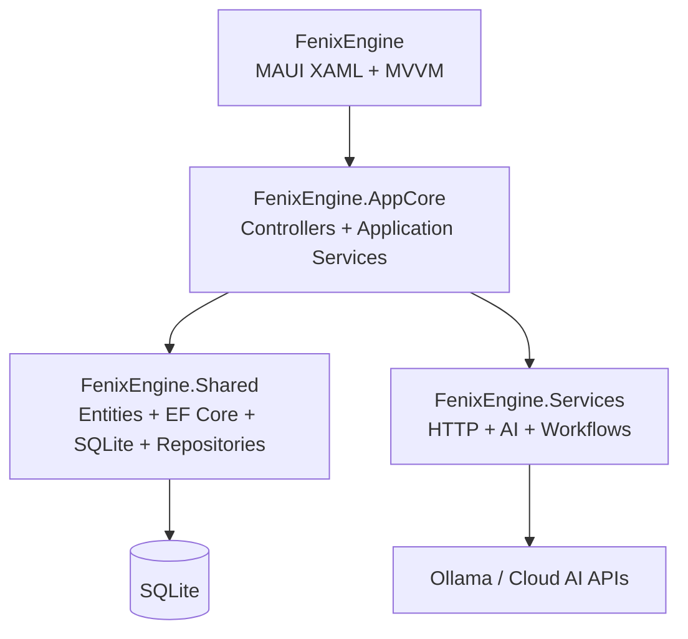

# FenixEngine

FenixEngine es una aplicación multiplataforma de asistencia al desarrollo de software construida con .NET MAUI. Permite organizar proyectos, actividades y tareas, y proporciona workflows para interactuar con agentes de inteligencia artificial locales y servicios compatibles con APIs de conversación.

El producto está orientado a arquitectos, analistas y desarrolladores que necesitan convertir especificaciones de diseño, decisiones técnicas y prompts en artefactos de software y documentación trazable.

## Qué producto se está desarrollando

FenixEngine funciona como un entorno local de trabajo para desarrollo asistido por IA. Su propósito es centralizar el contexto de un proyecto y facilitar la ejecución de acciones como:

- consultar proyectos y su última actividad;
- buscar actividades por texto y proyecto;
- consultar tareas agrupadas por proyecto;
- ejecutar prompts contra Ollama u otros endpoints compatibles;
- generar documentos RUP;
- generar estructuras iniciales de proyectos .NET;
- administrar proveedores cloud y agentes locales;
- conservar datos de trabajo en SQLite.

La aplicación se encuentra en fase de prototipo funcional. La base de arquitectura, persistencia, navegación y UI está implementada; las operaciones CRUD completas, la seguridad de producción y las pruebas automatizadas siguen en desarrollo.

## Funcionalidades actuales

### Interfaz MAUI

La aplicación cuenta con las siguientes páginas:

- **LoginPage:** autenticación local para pruebas.
- **MainPage:** dashboard de proyectos.
- **WorkStationPage:** proyectos activos, búsqueda y actividades filtrables.
- **TaskPage:** tareas agrupadas por proyecto y estado.
- **SettingsPage:** configuración de proveedores de IA cloud y agentes locales.

La UI utiliza MVVM y está organizada en:

```text
FenixEngine/Src/
├── Components/pages/
│   ├── LoginPage.xaml
│   ├── MainPage.xaml
│   ├── WorkStationPage.xaml
│   ├── TaskPage.xaml
│   └── SettingsPage.xaml
└── ModelView/
    ├── LoginPageViewModel.cs
    ├── MainPageViewModel.cs
    ├── WorkStationPageViewModel.cs
    ├── TaskPageViewModel.cs
    └── SettingsPageViewModel.cs
```

### Persistencia local

SQLite y Entity Framework Core almacenan:

- usuarios;
- proyectos y tipos de proyecto;
- actividades;
- tareas;
- tokens de proveedores cloud;
- configuración de agentes locales.

Los repositorios se encuentran en `FenixEngine.Shared` y la lógica de aplicación que los consume se encuentra en `FenixEngine.AppCore`.

### Agentes y workflows de IA

Los servicios de `FenixEngine.Services` permiten:

- ejecutar prompts;
- generar documentos RUP;
- generar estructuras de arquitectura y proyecto;
- crear carpetas y archivos;
- comunicarse con endpoints HTTP compatibles con OpenAI.

Configuración local de desarrollo:

```text
Endpoint: http://127.0.0.1:11434/v1/
Modelo: llama3
Proveedor local recomendado: Ollama
```

## Arquitectura



### Proyectos de la solución

#### `FenixEngine`

Aplicación ejecutable .NET MAUI. Contiene las páginas XAML, ViewModels, navegación, composición de dependencias e inicialización de la base local.

#### `FenixEngine.Shared`

Contiene modelos de dominio, contratos, servicios comunes, `ServiceDbContext`, inicialización SQLite y repositorios.

#### `FenixEngine.Services`

Contiene cliente HTTP, agentes de IA, construcción de prompts y servicios de workflow para generación de prompts, documentos y estructuras de proyecto.

#### `FenixEngine.AppCore`

Coordina los casos de uso de la aplicación mediante controladores y servicios como `ProjectPortfolioController`, `WorkflowController`, `ProjectDataService`, `SettingsDataService` y `AuthenticationService`.

## Inicio de sesión de pruebas

En configuración `DEBUG`, la base se recrea al iniciar para mantener el esquema y los datos seed sincronizados.

```text
Usuario: admin@fenixengine.local
Contraseña: fenix123
```

Estas credenciales solo son válidas para pruebas locales. No deben utilizarse en un entorno de producción.

## Requisitos

- .NET 10 SDK.
- Workloads de .NET MAUI instalados.
- SDK de la plataforma objetivo.
- Ollama, si se desean ejecutar modelos locales.
- Un endpoint compatible con OpenAI, si se desea utilizar un proveedor remoto.

## Compilación

Ejemplo para MacCatalyst:

```bash
dotnet build -t:Build \
  -p:Configuration=Debug \
  -f net10.0-maccatalyst \
  -r maccatalyst-arm64 \
  -p:MauiDevFlowEnabled=true \
  FenixEngine/FenixEngine.csproj
```

También puede compilarse la solución completa:

```bash
dotnet build FenixEngine.slnx -p:MauiDevFlowEnabled=true
```

## Estado del desarrollo

### Implementado

- Arquitectura por capas.
- Inyección de dependencias entre proyectos.
- UI MAUI con navegación básica.
- Separación MVVM.
- Persistencia SQLite con EF Core.
- Repositorios de proyectos, actividades, tareas, usuarios y configuración.
- Login local de pruebas.
- Dashboard, WorkStation, tareas y Settings.
- Ejecución de prompts y workflows de generación.
- Inicialización compatible con bases existentes.

### Próximos incrementos

- CRUD visual completo de proyectos.
- Persistencia de cambios en Settings desde los switches.
- Gestión completa de actividades y tareas.
- Migraciones EF Core formales para producción.
- Sesión persistente, logout y autorización.
- Almacenamiento seguro de credenciales y tokens.
- Pruebas unitarias y de integración.
- Actualización de la dependencia SQLite vulnerable.
- Validación visual automatizada en dispositivos y simuladores.

## Documentación

- [Documentación general del proyecto](.Doc/wiki/proyecto.md)
- [Documentación RUP del contexto actual](.Doc/Contexto%20Actual/documentacion%20RUP.md)
- [Licencia GPLv3](LICENSE.txt)

## Licencia

FenixEngine se distribuye bajo la licencia GNU General Public License v3.0 o posterior. Consulta [LICENSE.txt](LICENSE.txt) para conocer los términos completos.


